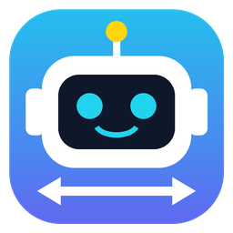

<p align="center"></p>

# 小柯機器人遠端連線

Windows 11 ↔ Windows 11、Windows 11 ↔ macOS 的遠端協助工具。一端是**主控端**、一端是**被控端**：主控端輸入被控端的 **ID + 授權碼**，即可看到並操作被控端的畫面。

架構參考開源專案 [RustDesk](https://github.com/rustdesk/rustdesk)：ID 伺服器負責讓兩端找到彼此，畫面、聲音、檔案走 **WebRTC 點對點加密直連**，直連不通時才經 TURN 中繼。可使用公用伺服器（免設定），也可用 `server/` 自架。

## 功能

| | 功能 | 說明 |
|---|---|---|
| 🖥️ | 遠端操控 | ID + 授權碼連線；滑鼠、鍵盤、滾輪；多螢幕切換；特殊鍵（Win、Ctrl+Shift+Esc、Alt+Tab、⌘+Space…）；剪貼簿雙向傳送；Mac ⌘ ↔ Windows Ctrl 自動對應；顯示直連/中繼、解析度、fps、頻寬 |
| 📁 | 一、檔案上傳下載 | 瀏覽被控端授權資料夾、下載、上傳（可拖曳）、建立資料夾、刪除、傳輸進度與取消；檔案走獨立資料通道，不影響操控 |
| 💬 | 二、互相聊天 | 文字訊息、**語音交談**（雙向、可靜音）、**畫面擷取傳送**（可拖曳裁切；主控端也可擷取遠端畫面）、圖片與任意檔案互傳 |
| 🔐 | 三、資料夾授權 | 被控端自行設定每個資料夾為「可讀／可寫／可讀寫」；一鍵建立「遠端安裝區」；主控端可要求**執行安裝程式**，被控端按「允許執行」才會執行（系統安裝協助） |
| 🎓 | 四、遠端線上教學 | 主控端把簡報推送到被控端全螢幕顯示：PDF、PowerPoint（.pptx/.ppt，自動轉檔）、Keynote、圖片；**同步翻頁、雷射筆、畫筆**；也可推送主控端自己的螢幕或某個視窗 |

安全設計：授權碼每次連線後自動更換（也可設固定授權碼做無人值守）、錯 5 次鎖定 1 分鐘、可要求被控端按「接受」、被控端可隨時暫停操控或中斷、檔案存取限制在授權資料夾內（阻擋 `..`、絕對路徑、符號連結跳出）。

## 安裝

到 [Releases](https://github.com/achir1015/xiaoke-remote/releases/latest) 下載：

- **Windows 11**：`XiaokeRemote-<版本>-win-x64.exe`，執行後依畫面安裝（可選安裝位置，會建立桌面與開始功能表捷徑）。未簽章，若出現 SmartScreen 請按「其他資訊 → 仍要執行」。
- **macOS**：Apple 晶片下載 `mac-arm64.dmg`，Intel 下載 `mac-x64.dmg`。把 App 拖進「應用程式」。
  - 未經 Apple 公證，第一次開啟請在 App 上按右鍵 →「打開」；若顯示「已損毀」，在終端機執行：
    ```bash
    xattr -cr "/Applications/小柯機器人遠端連線.app"
    ```
  - 作為**被控端**時，需在「系統設定 › 隱私權與安全性」開啟 **螢幕錄製**（分享畫面）與 **輔助使用**（接受滑鼠鍵盤），開啟後重新啟動 App。語音交談會詢問麥克風權限。

## 使用方式

1. 被控端開啟 App，把首頁的 **本機 ID** 與 **授權碼** 告訴主控端。
2. 主控端在「主控端：控制遠端電腦」輸入 ID 與授權碼 →「連線並操控」（或「僅檢視連線」）。
3. 被控端預設會跳出「接受／拒絕」確認（可在設定關閉）。
4. 連線後主控端右側有 **聊天／檔案／教學** 三個分頁。
5. 被控端要讓對方存取檔案，請先到「資料夾授權」新增資料夾並設定權限。

## 自架伺服器（選用）

公用伺服器（PeerJS Cloud）免設定即可使用。若要完全自主掌控，或兩端網路有嚴格防火牆，請使用 `server/`：

```bash
cd server
docker compose up -d
```

- `xiaoke-id`（port 9000）：ID／信令伺服器，相當於 RustDesk 的 hbbs。
- `turn`（coturn，port 3478）：中繼伺服器，相當於 RustDesk 的 hbbr，請先修改 `TURN_PASSWORD` 與 `external-ip`。

不用 Docker 也可以：`cd server && npm install && npm start`。

然後在兩端 App 的「設定 › 連線伺服器」選「自架伺服器」，填入主機、埠 9000、路徑 `/`、金鑰 `peerjs`；TURN 填 `turn:你的主機:3478`、帳號 `xiaoke`、密碼。**兩端必須使用同一台 ID 伺服器。**

## 開發

需要 Node.js 20。

```bash
npm install
npm start                 # 執行
npm test                  # 單元測試（資料夾授權沙箱）
npm run e2e -- <測試資料夾>  # 端對端測試：開兩個實例互連，測試全部功能（資料夾內需有 deck.pdf、big.bin，可加 deck.pptx）
npm run dist:win          # 打包 Windows 安裝檔（dist/）
npm run dist:mac          # 打包 macOS dmg（需在 Mac 上執行）
```

同一台電腦可用 `--profile=名稱` 開多個實例測試，`--dry-input` 只記錄滑鼠鍵盤事件不實際操作。

推送到 `main` 時 GitHub Actions 會在 Windows 與 macOS（Apple 晶片、Intel）建置安裝檔，並以 `package.json` 的版本號建立 Release。發佈新版：修改 `package.json` 的 `version` 後推送即可。

### 專案結構

```
src/main/main.js       主程序：視窗、系統匣、IPC、檔案 I/O、簡報轉 PDF、執行安裝檔確認
src/main/input.js      被控端滑鼠鍵盤注入（nut-js），跨平台修飾鍵對應
src/main/fsguard.js    資料夾授權沙箱（可讀/可寫/可讀寫）
src/main/preload.js    提供給畫面的安全 API
src/renderer/js/net.js     ID 伺服器連線、資料通道訊息、RPC、分段傳檔
src/renderer/js/app.js     首頁、被控端與主控端流程、遠端畫面與輸入
src/renderer/js/chat.js    文字、語音、畫面擷取、檔案互傳
src/renderer/js/files.js   主控端檔案總管、被控端檔案服務
src/renderer/js/teach.js   線上教學（pdf.js 投影片、雷射筆、畫筆、螢幕推送）
server/                自架 ID 伺服器 + coturn
e2e/run.mjs            端對端測試
```

## 已知限制

- Windows 的 UAC 提權視窗（安全桌面）與登入畫面無法遠端操作；被控端需自行按下 UAC 的「是」。
- 被控端必須開著 App（可縮到系統匣）；目前不是 Windows 服務 / macOS 背景常駐程式。
- 安裝檔未經程式碼簽章與 Apple 公證。

## 授權

MIT License © 2026 吳玉柱（achir1015@gmail.com）。相依套件：Electron、PeerJS、pdf.js、nut-js（各自授權）。
